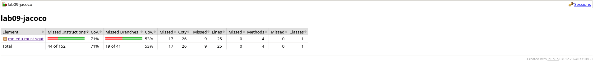
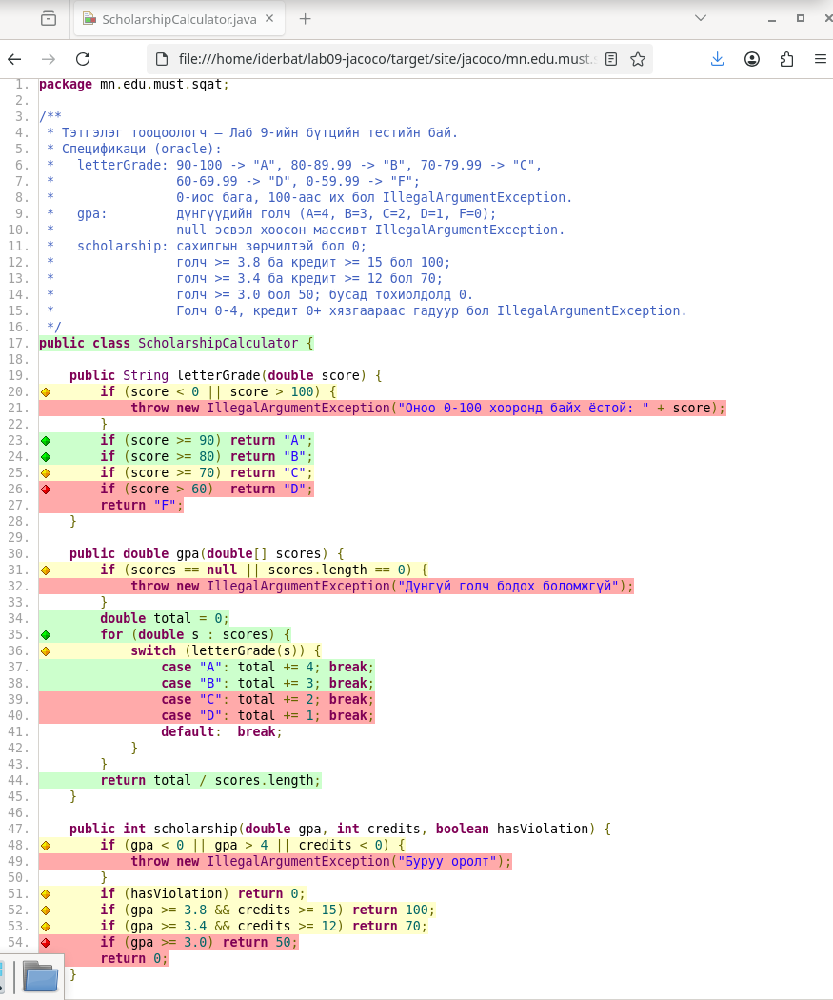

# F.CSA313 Лаборатори 9 — Код хамралт, JaCoCo

## 1. Оюутны мэдээлэл

- **Оюутны нэр:** Б.Идэрбат
- **Оюутны код:** B242270075
- **Хичээл:** F.CSA313 — Программ хангамжийн чанарын баталгаа ба тест
- **Лаборатори:** №9
- **Үйлдлийн систем:** Debian GNU/Linux 13.7 (trixie)

## 2. Ажлын орчин

### Java хувилбар

```text
openjdk version "21.0.12.1" 2026-08-18
OpenJDK Runtime Environment (build 21.0.12.1+1-1-deb13u1-Debian)
OpenJDK 64-Bit Server VM (build 21.0.12.1+1-1-deb13u1-Debian, mixed mode, sharing)
```

### Maven хувилбар

```text
Apache Maven 3.9.9
Maven home: /usr/share/maven
Java version: 21.0.12.1, vendor: Debian, runtime: /usr/lib/jvm/java-21-openjdk-amd64
Default locale: en_US, platform encoding: UTF-8
OS name: "linux", version: "6.12.107+deb13-amd64", arch: "amd64", family: "unix"
```

### Тестийн хэрэгслүүд

- JUnit Jupiter 5.10.2
- JaCoCo 0.8.12
- Maven Surefire 3.2.5
- Java compiler release 17

## 3. Ажлын зорилго

JaCoCo ашиглан ScholarshipCalculator классын бүтцийн хамралтыг
хэмжиж, тайлангийн үр дүнд үндэслэн тестүүдийг нэмэгдүүлэх,
CFG боловсруулах, давталтын болон зааг утгын тестээр
бүтцийн хамралтын хязгаарлалтыг судлах.

## 4. Анхны төлөв

Багшийн өгсөн starter төслийн эх кодыг архив дахь эх кодтой
cmp командаар харьцуулж, өөрчлөгдөөгүйг баталгаажуулсан.

Тест нэмэхээс өмнө mvn clean verify ажиллуулахад:

- No tests to run.
- Skipping JaCoCo execution due to missing execution data file.
- BUILD SUCCESS
- Maven exit code: 0

Тест байхгүй үед JaCoCo execution data үүсээгүй тул
HTML хамралтын тайлан гараагүй.

## 5. Хэсэг A — Happy path тестүүд

### 5.1. Тестийн тохиолдлууд

| ID | Тестийн метод | Оролт | Хүлээгдэх үр дүн |
|---|---|---|---|
| A-01 | letterGradeReturnsA | 95 | A |
| A-02 | letterGradeReturnsC | 75 | C |
| A-03 | gpaReturnsAverage | [95, 85] | 3.5 |
| A-04 | scholarshipReturns100Percent | 3.9, 16, false | 100 |
| A-05 | scholarshipReturns70Percent | 3.6, 13, false | 70 |

### 5.2. Тестийн үр дүн

- Tests run: 5
- Failures: 0
- Errors: 0
- Skipped: 0
- Maven exit code: 0
- BUILD SUCCESS

### 5.3. JaCoCo хамралтын үр дүн

| Хамралтын төрөл | Covered | Missed | Total | Хамралт |
|---|---:|---:|---:|---:|
| Instruction | 108 | 44 | 152 | 71.05% |
| Branch | 22 | 19 | 41 | 53.66% |
| Line | 16 | 9 | 25 | 64.00% |
| Complexity | 9 | 17 | 26 | 34.62% |
| Method | 4 | 0 | 4 | 100.00% |

Хамралтын хувийг Covered / (Covered + Missed) * 100
томьёогоор results/jacoco-A.csv файлаас тооцоолсон.

Branch хамралт 22/41 буюу 53.66%, Line хамралт 16/25 буюу
64.00% гарсан нь лабораторийн зааварт өгсөн жишигтэй нийцсэн.

### 5.4. Шар ромбо болон улаан мөрүүдийн ажиглалт

20, 25, 31, 36, 48, 51, 52, 53-р мөрүүдийн шар ромбо нь
нөхцөлүүдийн зарим салаа хамрагдаагүйг харуулсан.
21, 32, 49-р мөрийн exception замууд, 26-27-р мөрийн D/F
дүнгийн замууд, 39-40-р мөрийн C/D switch салаанууд болон
54-55-р мөрийн 50% ба 0% тэтгэлгийн замууд улаан байсан.
Иймээс хэвийн урсгалын таван тест нь бүх методыг ажиллуулсан
боловч алдааны болон бусад салааг бүрэн шалгаагүй байна.

### 5.5. Нотолгооны файлууд

- [Maven verify log](results/mvn-verify-A.txt)
- [JaCoCo CSV](results/jacoco-A.csv)




