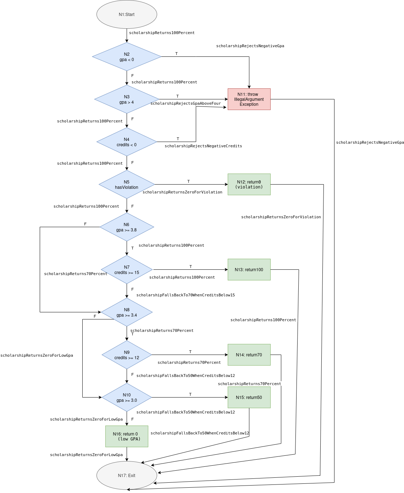
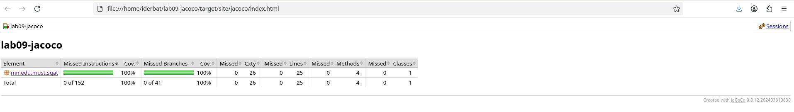
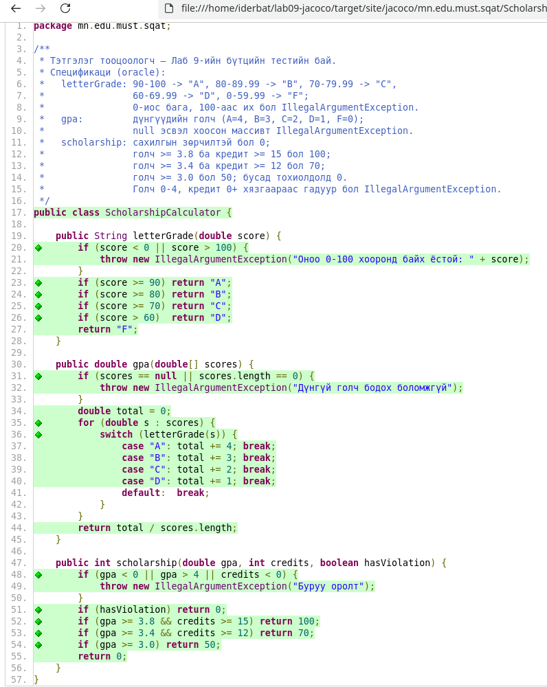

# F.CSA313 Лаборатори 9 — Код хамралт, JaCoCo

## 1. Оюутны мэдээлэл

- **Оюутны нэр:** Б.Идэрбат
- **Оюутны код:** B242270075
- **Хичээл:** F.CSA313 — Программ хангамжийн чанарын баталгаа ба тест
- **Лаборатори:** №9
- **Үйлдлийн систем:** Debian GNU/Linux 13.7 (trixie)

## 2. Ажлын орчин

### Java хувилбар

```text
openjdk version "21.0.12.1" 2026-08-18
OpenJDK Runtime Environment (build 21.0.12.1+1-1-deb13u1-Debian)
OpenJDK 64-Bit Server VM (build 21.0.12.1+1-1-deb13u1-Debian, mixed mode, sharing)
```

### Maven хувилбар

```text
Apache Maven 3.9.9
Maven home: /usr/share/maven
Java version: 21.0.12.1, vendor: Debian, runtime: /usr/lib/jvm/java-21-openjdk-amd64
Default locale: en_US, platform encoding: UTF-8
OS name: "linux", version: "6.12.107+deb13-amd64", arch: "amd64", family: "unix"
```

### Тестийн хэрэгслүүд

- JUnit Jupiter 5.10.2
- JaCoCo 0.8.12
- Maven Surefire 3.2.5
- Java compiler release 17

## 3. Ажлын зорилго

JaCoCo ашиглан ScholarshipCalculator классын бүтцийн хамралтыг
хэмжиж, тайлангийн үр дүнд үндэслэн тестүүдийг нэмэгдүүлэх,
CFG боловсруулах, давталтын болон зааг утгын тестээр
бүтцийн хамралтын хязгаарлалтыг судлах.

## 4. Анхны төлөв

Багшийн өгсөн starter төслийн эх кодыг архив дахь эх кодтой
cmp командаар харьцуулж, өөрчлөгдөөгүйг баталгаажуулсан.

Тест нэмэхээс өмнө mvn clean verify ажиллуулахад:

- No tests to run.
- Skipping JaCoCo execution due to missing execution data file.
- BUILD SUCCESS
- Maven exit code: 0

Тест байхгүй үед JaCoCo execution data үүсээгүй тул
HTML хамралтын тайлан гараагүй.

## 5. Хэсэг A — Happy path тестүүд

### 5.1. Тестийн тохиолдлууд

| ID | Тестийн метод | Оролт | Хүлээгдэх үр дүн |
|---|---|---|---|
| A-01 | letterGradeReturnsA | 95 | A |
| A-02 | letterGradeReturnsC | 75 | C |
| A-03 | gpaReturnsAverage | [95, 85] | 3.5 |
| A-04 | scholarshipReturns100Percent | 3.9, 16, false | 100 |
| A-05 | scholarshipReturns70Percent | 3.6, 13, false | 70 |

### 5.2. Тестийн үр дүн

- Tests run: 5
- Failures: 0
- Errors: 0
- Skipped: 0
- Maven exit code: 0
- BUILD SUCCESS

### 5.3. JaCoCo хамралтын үр дүн

| Хамралтын төрөл | Covered | Missed | Total | Хамралт |
|---|---:|---:|---:|---:|
| Instruction | 108 | 44 | 152 | 71.05% |
| Branch | 22 | 19 | 41 | 53.66% |
| Line | 16 | 9 | 25 | 64.00% |
| Complexity | 9 | 17 | 26 | 34.62% |
| Method | 4 | 0 | 4 | 100.00% |

Хамралтын хувийг Covered / (Covered + Missed) * 100
томьёогоор results/jacoco-A.csv файлаас тооцоолсон.

Branch хамралт 22/41 буюу 53.66%, Line хамралт 16/25 буюу
64.00% гарсан нь лабораторийн зааварт өгсөн жишигтэй нийцсэн.

### 5.4. Шар ромбо болон улаан мөрүүдийн ажиглалт

20, 25, 31, 36, 48, 51, 52, 53-р мөрүүдийн шар ромбо нь
нөхцөлүүдийн зарим салаа хамрагдаагүйг харуулсан.
21, 32, 49-р мөрийн exception замууд, 26-27-р мөрийн D/F
дүнгийн замууд, 39-40-р мөрийн C/D switch салаанууд болон
54-55-р мөрийн 50% ба 0% тэтгэлгийн замууд улаан байсан.
Иймээс хэвийн урсгалын таван тест нь бүх методыг ажиллуулсан
боловч алдааны болон бусад салааг бүрэн шалгаагүй байна.

### 5.5. Нотолгооны файлууд

- [Maven verify log](results/mvn-verify-A.txt)
- [JaCoCo CSV](results/jacoco-A.csv)


## 6. Хэсэг B — Бүтцийн хамралтыг 100% хүргэх

### 6.1. Нэмэлт тестүүд

Хэсэг A-ийн 5 тестийг хэвээр хадгалж, хамрагдаагүй
19 салааг хамруулахын тулд 14 шинэ тест нэмсэн.

| Тестийн метод | Оролт | Хүлээгдэх үр дүн |
|---|---|---|
| letterGradeReturnsD | 65 | D |
| letterGradeReturnsF | 55 | F |
| letterGradeRejectsNegativeScore | -1 | IllegalArgumentException |
| letterGradeRejectsScoreAbove100 | 101 | IllegalArgumentException |
| gpaCoversRemainingGrades | [75, 65, 55] | 1.0 |
| gpaRejectsNullArray | null | IllegalArgumentException |
| gpaRejectsEmptyArray | [] | IllegalArgumentException |
| scholarshipRejectsNegativeGpa | -0.1, 16, false | IllegalArgumentException |
| scholarshipRejectsGpaAboveFour | 4.1, 16, false | IllegalArgumentException |
| scholarshipRejectsNegativeCredits | 3.9, -1, false | IllegalArgumentException |
| scholarshipReturnsZeroForViolation | 3.9, 16, true | 0 |
| scholarshipFallsBackTo70WhenCreditsBelow15 | 3.9, 14, false | 70 |
| scholarshipFallsBackTo50WhenCreditsBelow12 | 3.6, 11, false | 50 |
| scholarshipReturnsZeroForLowGpa | 2.9, 16, false | 0 |

### 6.2. Short-circuit нөхцөлийн хамралт

OR нөхцөлийн бүрэлдэхүүн тус бүрийг дараах байдлаар
гурван тусдаа assertThrows тестээр шалгасан.

| GPA | Credits | gpa < 0 | gpa > 4 | credits < 0 |
|---:|---:|---|---|---|
| -0.1 | 16 | T | - | - |
| 4.1 | 16 | F | T | - |
| 3.9 | -1 | F | F | T |
| 3.9 | 16 | F | F | F |

"-" тэмдэг нь short-circuit ажиллагааны улмаас
тухайн нөхцөл үнэлэгдээгүйг илэрхийлнэ.

AND нөхцөлүүдийн хувьд голч шаардлага хангасан боловч
кредит дутуу байх тохиолдлуудыг тусад нь шалгасан.
3.9 голч, 14 кредитэд 70%, 3.6 голч, 11 кредитэд
50% тэтгэлэг олгогдож байгааг баталгаажуулсан.

gpaCoversRemainingGrades тестээр C, D болон
F дүнгийн switch салаануудыг хамруулсан.

### 6.3. Control Flow Graph (CFG)



scholarship() функцийн CFG-г draw.io ашиглан зурсан.
CFG нь 17 зангилаа, 25 логик ирмэг, 9 атомар
шийдвэрийн зангилаатай.

Ирмэг бүрд тухайн замыг дайрдаг бодит JUnit
тестийн методын нэрийг тэмдэглэсэн.

Цикломатик төвөгшил:

- V(G) = E - N + 2 = 25 - 17 + 2 = 10
- V(G) = P + 1 = 9 + 1 = 10

scholarship() функцийн нөхцөлт салааны тоо 18.
CFG-ийн 25 ирмэгт нөхцөлгүй шилжилтүүд мөн багтана.

### 6.4. Maven тестийн үр дүн

- Хэсэг A-ийн тест: 5
- Хэсэг B-д нэмсэн тест: 14
- Tests run: 19
- Failures: 0
- Errors: 0
- Skipped: 0
- Maven exit code: 0
- BUILD SUCCESS

### 6.5. JaCoCo хамралтын үр дүн

| Хамралтын төрөл | Covered | Missed | Total | Хамралт |
|---|---:|---:|---:|---:|
| Instruction | 152 | 0 | 152 | 100.00% |
| Branch | 41 | 0 | 41 | 100.00% |
| Line | 25 | 0 | 25 | 100.00% |
| Complexity | 26 | 0 | 26 | 100.00% |
| Method | 4 | 0 | 4 | 100.00% |

results/jacoco-B.csv файлд BRANCH_MISSED = 0,
LINE_MISSED = 0 болсон.

Нийт 19 тестээр ScholarshipCalculator классын
Branch болон Line хамралтыг 100% хүргэсэн.
JaCoCo XML тайлангаар хамрагдаагүй instruction
болон branch үлдээгүйг баталгаажуулсан.

### 6.6. Хэсэг A, B-ийн харьцуулалт

| Үзүүлэлт | Хэсэг A | Хэсэг B |
|---|---:|---:|
| Tests run | 5 | 19 |
| Instruction coverage | 71.05% | 100.00% |
| Branch coverage | 53.66% | 100.00% |
| Line coverage | 64.00% | 100.00% |
| Complexity coverage | 34.62% | 100.00% |
| Method coverage | 100.00% | 100.00% |

Хэсэг B-ийн төгсгөлд starter эх кодыг архив дахь
анхны файлтай cmp командаар харьцуулж, өөрчлөгдөөгүйг
баталгаажуулсан. 26-р мөрийн score > 60 нөхцөл
хэвээр байсан.

### 6.7. Нотолгооны файлууд

- [Maven verify B](results/mvn-verify-B.txt)
- [JaCoCo B CSV](results/jacoco-B.csv)
- [Control Flow Graph](cfg.png)





## 7. Хэсэг C — Давталтын заагийн тестүүд

### 7.1. 0 / 1 / 2+ дүрэм

gpa() функцийн for давталтыг Лекц 9-ийн
0 / 1 / 2+ дүрмийн дагуу шалгасан.

| Давталтын тоо | Тестийн метод | Оролт | Хүлээгдэх үр дүн |
|---|---|---|---|
| 0 | gpaRejectsEmptyArray | [] | IllegalArgumentException |
| Null оролт | gpaRejectsNullArray | null | IllegalArgumentException |
| 1 | gpaSingleScoreReturnsFour | [95] | 4.0 |
| 2+ (4 удаа) | gpaFourScoresReturnsAverage | [95, 85, 75, 65] | 2.5 |

Хоосон болон null массивын тестүүдийг Хэсэг B-д
assertThrows ашиглан бичсэн тул давхардуулалгүй ашигласан.
Хоосон массивын хувьд давталт эхлэхээс өмнө оролтын
шалгалтаар exception шидэгдэнэ.

Нэг элементтэй массивын голч нь тухайн элементийн
дүнгийн оноотой тэнцүү байна.

Дөрвөн элементтэй массивын голч:

GPA = (4 + 3 + 2 + 1) / 4 = 2.5

### 7.2. Тестийн үр дүн

- Өмнөх тестийн тоо: 19
- Нэмсэн тестийн тоо: 2
- Tests run: 21
- Failures: 0
- Errors: 0
- Skipped: 0
- Maven exit code: 0
- BUILD SUCCESS

### 7.3. Хамралтын харьцуулалт

| Үзүүлэлт | Хэсэг B | Хэсэг C |
|---|---:|---:|
| Tests run | 19 | 21 |
| Instruction coverage | 152/152 (100%) | 152/152 (100%) |
| Branch coverage | 41/41 (100%) | 41/41 (100%) |
| Line coverage | 25/25 (100%) | 25/25 (100%) |

jacoco-B.csv болон jacoco-C.csv файлуудыг cmp
командаар харьцуулахад ижил байсан.

### 7.4. Давталтын тестүүдийн ач холбогдол

Branch болон Line хамралт аль хэдийн 100% байсан тул
давталтын шинэ тестүүд хамралтын хувийг нэмэгдүүлээгүй.
Гэхдээ эдгээр тест нь давталт эхлэхгүй, нэг удаа болон
олон удаа ажиллах үед оролтын шалгалт, нийлбэрийн
хуримтлал, голчийн тооцоолол зөв байгааг тусад нь
баталгаажуулдаг учраас шаардлагатай хэвээр байна.

### 7.5. Нотолгооны файлууд

- [Maven verify C](results/mvn-verify-C.txt)
- [JaCoCo C CSV](results/jacoco-C.csv)

## 8. Хэсэг D — 100% хамралттай кодын зааг утгын алдаа

### 8.1. Зааг утгын тестүүд

Хэсэг B болон C-д Branch, Line хамралт 100% болсон
боловч кодын зөв ажиллагааг бүрэн батлахгүй.
Иймээс letterGrade() функцийн спецификацид үндэслэн
долоон зааг утгын тест нэмсэн.

| Тестийн метод | Оролт | Expected | Actual (засварын өмнө) | Үр дүн |
|---|---:|---|---|---|
| letterGradeBoundary60ReturnsD | 60 | D | F | FAIL |
| letterGradeBoundary5999ReturnsF | 59.99 | F | F | PASS |
| letterGradeBoundary6999ReturnsD | 69.99 | D | D | PASS |
| letterGradeBoundary0ReturnsF | 0 | F | F | PASS |
| letterGradeBoundary100ReturnsA | 100 | A | A | PASS |
| letterGradeBoundary8999ReturnsB | 89.99 | B | B | PASS |
| letterGradeBoundary90ReturnsA | 90 | A | A | PASS |

### 8.2. Алдаа илрүүлсэн туршилтын үр дүн

- Tests run: 28
- Passed: 27
- Failures: 1
- Errors: 0
- Skipped: 0
- Maven exit code: 1
- BUILD FAILURE

Унасан тест: `letterGradeBoundary60ReturnsD`.

results/mvn-test-D-fail.txt файлаас авсан бодит алдааны мөр:

```text
[ERROR]   ScholarshipCalculatorTest.letterGradeBoundary60ReturnsD:185 expected: <D> but was: <F>
```

Surefire XML тайлангаар нийт 28 тестээс зөвхөн
letterGradeBoundary60ReturnsD тест унасныг баталгаажуулсан.

Энэ нь Maven тохиргооны алдаа биш, expected болон
actual утгын зөрүүнээс үүссэн assertion failure юм.

### 8.3. Алдааны үндсэн шалтгаан

ScholarshipCalculator.java файлын 26-р мөр:

```java
if (score > 60)  return "D";
```

Спецификацийн дагуу 60 оноо D байх ёстой.
Гэвч score > 60 нөхцөл нь яг 60 оноог False
салаа руу шилжүүлж, F дүн буцааж байна.

Өмнөх 55 болон 65 онооны тестүүд True, False
салааг бүрэн хамруулсан боловч яг 60 гэсэн
зааг утгыг шалгаагүй байсан.

### 8.4. Алдаа илрүүлэлтийн нотолгоо

- [Maven boundary failure log](results/mvn-test-D-fail.txt)
